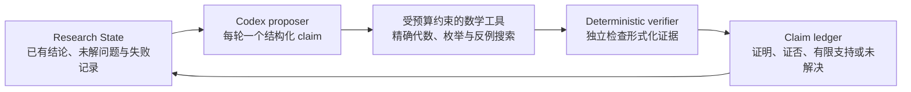
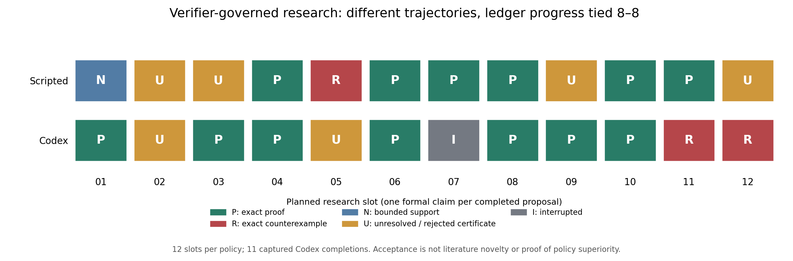

# RobustLoc-Agent
### 基于数学科研智能体的众包离线高精度定位研究

一个 AI for Math 课程项目，源于 HarmonyOS 众包离线定位难题。项目研究接收设备的位置和 RSSI 观测存在误差、异常和缺测时，目标何时能被可靠定位，以及智能体如何据此选择求解、拒绝或请求观测。距离定位是主线，相位恢复用于检验部分数学结构的可迁移性。

**静态和移动算法研究已完成并冻结。** 证据来自两份公开真实 BLE 数据、五类众包压力测试及六类半合成移动回放。原题的真实众包手机验收与移动目标检测仍待验证。

[静态研究总结](ble_crowd/STATIC_CLOSEOUT.md) · [完整实验报告](ble_crowd/REPORT.md) · [冻结清单](ble_crowd/STATIC_FREEZE.json) · [真实手机采集协议](ble_field/PROTOCOL.md)

## 静态定位结果

冻结的接收端校准 + Cauchy+MAD 在两处公开 BLE 场地的原始回放中，CEP90 分别为 **6.22 m** 和 **5.33 m**，输出覆盖率分别为 **82.03%** 和 **100%**。CEP90 只统计有输出的误差，缺测实验同时报告把无输出计入失败的总体成功率。

- **数量和布局。** B 场地从 3 端增至 12 端，CEP90 从 15.56 m 降至 5.69 m。四端均匀分散时为 9.40 m，单侧时为 18.37 m。
- **校准失配。** B 的校准迁到 A 后，CEP90 从 6.22 m 升至 58.04 m。
- **观测缺测。** 从六端随机删掉一半后，两场地有输出的 CEP90 均低于 12 m，总体 30 m 成功率约为 65%。

Cauchy+MAD 保留为原有冻结主方案，Soft-L1+MAD 保留为 verifier 验证通过的候选，WLS 保留为基线。Soft-L1 相对 Cauchy 在验证组合的 CEP90 改善 3.11%，超过 2% 门槛，满足场景回退、覆盖率和无新增弃权约束。最终留出组合中三者的 CEP90 分别为 11.91 m、11.46 m、**11.27 m**，WLS 最低。[验证裁决](ble_crowd/runs/crowd-001/round-02/verdict.json) · [最终复核](ble_crowd/runs/crowd-001/review.json)

B 的 12 个射频端由 4 台主机承载，A 的完整最终分区仅 1 个位置有至少 11 个有效接收端。真实众包验收仍需同窗至少 11 台独立手机与独立测量的目标真值。

## 移动定位结果

在 432 条半合成留出轨迹上，冻结 Cauchy+MAD 的全时刻 10 m 成功率为 75.36%，Kalman 为 84.16%，12 秒保持为 89.43%，最终 Adaptive Tracking 为 **90.13%**。Adaptive 相对冻结 Cauchy 提升 **19.59%**，未达到 20% 目标。两处自动静态回放通过原保护门槛。Adaptive 的输出覆盖率为 91.81%，与保持基线的 CEP90 同为 6.21 m，位置年龄 P90 分别为 5.98 s 和 5.79 s。

从完整观测进行 Kalman 修正或直接用当前解。缺测时根据运动证据、位置年龄与估计不确定性选择保持、部分距离修正、预测或弃权。留出集的补缺收益主要来自保持和部分距离修正。[移动报告](ble_mobile/adaptive/REPORT.md) · [独立复核](ble_mobile/runs/adaptive-001/review.json) · [移动冻结清单](ble_mobile/MOBILE_FREEZE.json)

## 数学研究 Agent

> **Codex proposes; deterministic verifier disposes.**
>
> 模型提出问题、猜想与证据，确定性验证器决定形式命题是否获准进入结论账本。

[Phase 5 完整报告](v5/runs/PHASE5_REVIEW.md) · [实现与复现说明](v5/README.md) · [最终对照数据](v5/runs/comparison-v3-001/comparison.json) · [跨问题迁移报告](v4/runs/PHASE4_REVIEW.md)

## 核心研究闭环

项目从鲁棒定位的经验失败出发，逐步形成“数学结构 → 恢复证书 → 主动决策 → 跨问题共享结构 → 自主研究选题”的闭环。Phase 5 的 proposer 是真实 Codex；早期规则型研究循环保留为历史实现，不混称为 LLM 自主研究。



模型根据当前状态选择下一研究动作，没有接收预排的轮次任务表。提案自身的“证明完成”声明不能授予状态；被拒绝的证书、失败的猜想修复和执行中断都保留在记录中。形式语言、工具与初始 frontier 由人提供。

## Phase 5：真实运行结果

两种策略使用相同初始研究状态、数学工具预算与验证规则。Scripted baseline 按预定任务策略执行；Codex 根据反馈自主选题。

| 指标 | Scripted baseline | Codex researcher |
|---|---:|---:|
| 计划研究槽位 | 12 | 12 |
| 完成的正式提案 | 12 | 11 |
| `proved-in-project` | 6 | 7 |
| `refuted` / 精确反例 | 1 | 2 |
| `numerically-supported` | 1 | 0 |
| 未解决（含执行失败） | 4 | 3 |
| 被拒绝的证明证书 | 0 | 2 |
| **有效形式账本推进** | **8** | **8** |

**本轮未证明 Codex 优于固定 workflow。** “有效推进”是预定的非重复、非空泛形式账本指标，不是原创定理数。Codex 的一项已验收证明因未提交非空域见证而不计推进；第七槽位中断，保留为失败，没有补造第十二份模型提案。

模型自行沿着“lifting 稳定性 → 测量扰动界 → 扩大适用范围 → 精确反例”的路线研究。两次证书被拒后，后续修正获得验收；最后一次缩小参数范围的猜想修复仍被证否。该轨迹支持受约束的自主选题与反馈迭代可执行，尚不支持普适自主数学发现或反馈作用的因果结论。



- [逐轮提案、模型回执与验证证据](v5/runs/paired-v2-codex-001/scientific/iterations/)
- [统一重放审计](v5/runs/comparison-v3-001/replay_audits.json)与[修复计数审计](v5/runs/comparison-v3-001/repair_audit.json)
- [实际调用成本](v5/runs/provider_costs.csv)：中断槽位用量未知，已捕获合计只是成本下界。
- 原运行验收记录：[220 项回归测试](v5/runs/final_test_verification.json)，另有 [1 项续跑测试](v5/runs/operations-resume-tests.xml)和 [3 项统计测试](v5/runs/metric-v3-tests.xml)。这些是已保存的执行结果，不表示本次首页更新重跑了测试。

## 按研究问题阅读

| 问题 | 内容与入口 |
|---|---|
| 经验失败能否形成研究问题？ | v1：固定 synthetic BLE benchmark 与规则型循环。[历史结果](RESULTS.md)、[历史报告](report/report.md) |
| 任意污染下，何时可辨识、可稳定恢复？ | v2：文献审计、几何信息裕度、局部/全局区别与反例。[理论路线](v2/README.md)、[全局稳定性](v2/global_stability/README.md) |
| 证书能否指导估计、拒绝与获取信息？ | v3：[certificate-driven decision agent](v3/README.md) |
| 证书依赖的假设、信任与行动成本如何处理？ | [v3b：assumption](v3b/README.md)、[v3c：trust](v3c/README.md)、[v3d：minimal trust / optimality](v3d/README.md) |
| 哪些结构可以跨逆问题复用？ | v4：共享数学核心 + Range / PR adapters，同时保留不成立的迁移。[实现](v4/README.md)、[迁移报告](v4/runs/PHASE4_REVIEW.md) |
| 下一步研究什么，能否由模型决定？ | v5：Research State、真实 Codex proposer、hard verifier gate 与 scripted 对照。[实现](v5/README.md)、[报告](v5/runs/PHASE5_REVIEW.md) |
| 真实 BLE 条件下，静态定位在哪些场景稳定？ | 两场地原始回放、校准迁移、五类众包压力及实地验收边界。[总结](ble_crowd/STATIC_CLOSEOUT.md)、[协议](ble_crowd/PROTOCOL.md) |

v4 的共享核心支持有限范围的结构迁移；PR 原点附近的 intensity 稳定裕度退化、sign quotient 下欧氏三点 witness 的直接迁移失败也保留在报告中。本轮 Codex 没有自主调用 Range/PR 共用 minimax 工具，不能把先前实现的跨问题能力归为此次自主运行的成果。

## 复现：先选择冻结快照

静态研究快照可用 `python -m ble_crowd.verify_freeze` 检查。重新运行实验请按照[静态实验协议](ble_crowd/PROTOCOL.md)使用新输出目录。

运行 `python -m ble_mobile.freeze.verify` 可核验两个冻结快照。[移动协议](ble_mobile/adaptive/PROTOCOL.md)给出独立复现入口。

**Phase 5 字节审计使用该阶段完成时的提交 `c734a7011c055cedd1d24a91be3e750962ad8f4c`。**

旧冻结清单包含根目录 `README.md` 等文件。静态研究收束后的首页和工作约定用于说明当前状态。使用原提交及原清单重放历史实验。

从已有仓库创建一个新的复现目录：

```powershell
git worktree add --detach ../RobustLoc-Agent-phase5-frozen c734a7011c055cedd1d24a91be3e750962ad8f4c
cd ../RobustLoc-Agent-phase5-frozen
python -m venv .venv
.\.venv\Scripts\python.exe -m pip install -r requirements.txt
.\.venv\Scripts\python.exe -m v5.runs.evaluator_v2.run replay v5/runs/paired-v2-scripted-001
.\.venv\Scripts\python.exe -m v5.runs.evaluator_v2.run replay v5/runs/paired-v2-codex-001
```

Python 3.10+；Linux/macOS 将解释器路径替换为 `.venv/bin/python`。复现目录需尚不存在；依赖范围见 [requirements.txt](requirements.txt)，记录的版本见 [environment.lock.txt](environment.lock.txt)。

以上重放使用已记录的真实模型提案，重新执行确定性检查，**不调用模型**。完整测试、统计重评分及新的模型运行入口见 [v5/README](v5/README.md)，在上述冻结 checkout 中执行；其中的解释器路径应替换为你实际的虚拟环境路径。新实验使用新输出目录，模型重新生成不保证得到相同轨迹。

## 证据边界与冻结约定

- 数学结论区分 `known / proved-in-project / conjectured / numerically-supported / refuted`；验证失败或尚未完成的提案保留为 `unresolved`。
- 文献状态独立使用 `known / novelty-uncertain`。证明一个形式命题不等于确认原创；冻结文献查询表也不是穷尽式文献搜索。
- 验证器只验收声明的形式命题与假设；自然语言解释、物理模型对应关系、真实传感器可信性不会自动获得证明。
- 有限枚举不能代替连续空间完备性；单条合成研究轨迹不能证明总体科研优势或工业适用性。
- `runs/run-001` 永久冻结，不再优化 CEP90。历史代码、实验、账本和报告保留；首页改版前的全部字节可在[冻结提交](https://github.com/WDYXG/RobustLoc-Agent/tree/c734a7011c055cedd1d24a91be3e750962ad8f4c)核验，[旧首页](https://github.com/WDYXG/RobustLoc-Agent/blob/c734a7011c055cedd1d24a91be3e750962ad8f4c/README.md)也完整保留。

课程报告与答辩可以按[静态研究](ble_crowd/STATIC_CLOSEOUT.md)、[移动实验](ble_mobile/adaptive/REPORT.md)和[数学研究 Agent](v5/runs/PHASE5_REVIEW.md)组织，分别呈现公开数据证据、移动目标差距与自主选题和验证器裁决。

早期循环设计参考 [Creative-Intelligence](https://github.com/DeepMathLLM/Creative-Intelligence) 的思想，未复制其代码。各阶段数学文献与已知结果边界见对应目录的 literature audit。
