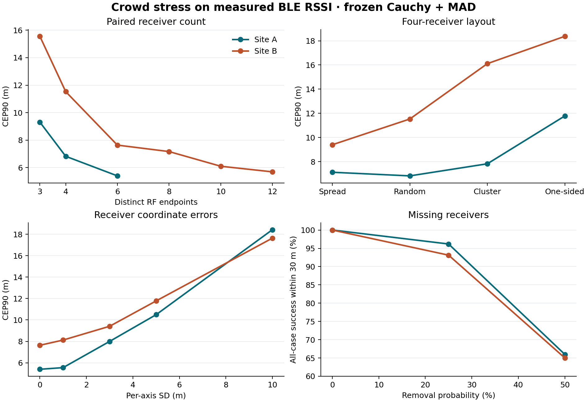

# 真实 BLE 众包压力测试

## 结论

在两个室内场地，使用本地接收端校准时，增加分散的有效接收端能改善定位。**影响稳定性最大的三项是校准迁移失配、有效接收端缺测和上报坐标误差。** B→A 迁移使冻结方案的 CEP90 从 6.22 m 增至 58.04 m。随机移除一半接收端后，两个场地的输出条件 CEP90 仍低于 12 m，但把无输出计入失败后，总体 30 m 成功率约为 65%。

B 的 12 个射频接收端在原始 BLE 回放中达到 CEP90 5.33 m、覆盖率 100%，为固定接收端条件下的静态定位提供数值支持。这 12 端由 4 台主机承载。A 的完整最终分区仅有 1 个位置、2 个窗口达到至少 11 个有效接收端。原题的独立众包手机条件仍待实测。

## 数据、指标和独立性

| 场地 | 使用的数据 | 接收端 | 校准 / 开发 / 验证 / 最终位置 | 完整最终窗口 |
| --- | --- | --- | --- | ---: |
| A | 2024 Indoor Environment Dataset，原始 1 秒 RSSI 行 | 15 个固定接收端 | 96 / 16 / 16 / 32 | 3,183 |
| B | Position-Annotated-BLE-RSSI-Dataset 静态 set_1，固定 5 秒窗口 | 12 个射频端，4 台主机 | 40 / 10 / 11 / 20 | 1,200 |

复用历史冻结的校准系数。每个位置每面板最多取 4 个哈希固定窗口，最终压力场景每窗 4 次扰动。以物理位置等权，在位置内对窗口及扰动等权。CEP50/CEP90 是有输出案例的径向误差分位数。覆盖率是输出比例，输出失败率为其补数。总体 30 m 成功率的分母含无输出和设计不可用案例。高人数档位的设计可用率另列，避免把缺少真实观测误计为求解器故障。

两场地均核验校准、开发、验证、最终分区物理坐标互斥。最终分区的底层位置在历史实验中已经报告过，本轮独立性限于事先锁定的新窗口抽样、压力配置及开发/验证隔离。几何场景用目标真值定义环绕和单侧组，定位器只收到接收端坐标、RSSI 和冻结配置。A 的 `-105` 和 B 的空值均按缺测保留。重复扫描只增加同一接收端的测量次数。

数据来源与历史结果见 [场地 A 数据发布](https://data.mendeley.com/datasets/3v9mcsvcd2/1)、[场地 B 数据发布](https://github.com/philotuxo/Position-Annotated-BLE-RSSI-Dataset)、[A 历史测试](../ble_research/runs/real-001/REPORT.md)、[B 历史测试](../ble_transfer/runs/transfer-001/REPORT.md)。本轮预设见 [实验协议](PROTOCOL.md)。

## 一、原始观测回放

该组使用真实 RSSI 和发布的米制坐标，无注入扰动。A 为 32 个位置、128 窗，B 为 20 个位置、80 窗。

| 场地 | 方法 | CEP50 (m) | CEP90 (m) | 覆盖率 | 无输出 | 总体 30 m 成功率 |
| --- | --- | ---: | ---: | ---: | ---: | ---: |
| A | 全布局中心 | 9.78 | 19.81 | 100% | 0 | 100% |
| A | 有效接收端中心 | 4.06 | 6.96 | 100% | 0 | 100% |
| A | 最强 RSSI 接收端 | 3.20 | 7.82 | 100% | 0 | 100% |
| A | WLS | 2.90 | 6.13 | 82.03% | 23 | 82.03% |
| A | 冻结 Cauchy+MAD | 3.12 | 6.22 | 82.03% | 23 | 82.03% |
| A | Soft-L1+MAD | 3.09 | 6.23 | 82.03% | 23 | 82.03% |
| B | 全布局中心 | 7.05 | 10.44 | 100% | 0 | 100% |
| B | 有效接收端中心 | 7.05 | 10.44 | 100% | 0 | 100% |
| B | 最强 RSSI 接收端 | 4.71 | 7.78 | 100% | 0 | 100% |
| B | WLS | 1.71 | 6.03 | 100% | 0 | 100% |
| B | 冻结 Cauchy+MAD | 1.80 | 5.33 | 100% | 0 | 100% |
| B | Soft-L1+MAD | 1.57 | 5.48 | 100% | 0 | 100% |

A 的 23 个无输出窗口均少于 3 个有效端。两场地全布局中心均满足 30 m 阈值，显示场地尺寸和已知布局本身可以提供很强的先验。B 中使用 RSSI 有助于区分更细的误差尺度。A 的有效端中心用较低的精度代价换来更高覆盖率。

### 自然有效接收端支持量

计数来自完整最终分区，单元格为窗口数 / 物理位置数。

| 场地 | ≥3 | ≥4 | ≥6 | ≥8 | ≥10 | ≥11 | ≥12 | ≥15 |
| --- | ---: | ---: | ---: | ---: | ---: | ---: | ---: | ---: |
| A | 2560 / 32 | 1899 / 29 | 740 / 24 | 142 / 11 | 15 / 3 | 2 / 1 | 0 / 0 | 0 / 0 |
| B | 1200 / 20 | 1200 / 20 | 1200 / 20 | 1200 / 20 | 1200 / 20 | 1200 / 20 | 1200 / 20 | 0 / 0 |

A 的无条件回放抽样未抽到 ≥10 端的窗口，因此另列高支持配对面板。B 无条件回放的 80 个窗口均有 12 个有效射频端，≥10 和 ≥11 的指标相同。不同主机数和射频端数逐例保留。

## 二、五类压力结果

下表使用冻结 Cauchy+MAD。完整结果含各对照方法、全部场景、CEP50、覆盖率及失败，见 [逐场景指标](runs/crowd-001/test-metrics.json)。

### 1. 接收端数量

表中为 CEP90（m）。A 的主面板 24 个位置，高支持面板 3 个位置、7 个不同原始窗口；B 的 20 个位置在 3–12 档位使用相同窗口。每个条件都从同一真实可见集合取固定随机排列的前缀。

| 配对面板 | 3 | 4 | 6 | 8 | 10 | 12 | 15 |
| --- | ---: | ---: | ---: | ---: | ---: | ---: | ---: |
| A 主面板 | 9.31 | 6.82 | 5.40 | 5.78† | — | — | — |
| A 高支持面板 | 6.90 | 4.71 | 6.26 | 4.08 | 3.41 | — | — |
| B 主面板 | 15.56 | 11.53 | 7.64 | 7.17 | 6.10 | 5.69 | — |

† A 的主面板 8 端组仅 28/348 次设计可用，位置加权可用率 7.29%，其 CEP90 条件于该小部分窗口。A 的高支持面板只有 3 个位置，4→6 的尾部误差反而增加。B 的样本上，3→6 的收益大于 6→12。位置配对的平均误差变化在 3→6 时为 A −1.57 m、B −3.03 m，95% 位置重抽样区间分别为 [−2.37, −0.87]、[−3.92, −2.11] m。15 端两场地均无真实单窗支持。

### 2. 空间分布

四接收端保持同窗和同位置，按真实几何选择子集。数值为 CEP90（m），括号内为目标视角的覆盖弧中位数。

| 场地 | 均匀分散 | 随机 | 集中 | 单侧 |
| --- | ---: | ---: | ---: | ---: |
| A | 7.12 (188°) | 6.82 (144°) | 7.82 (107°) | 11.78 (70°) |
| B | 9.40 (233°) | 11.53 (121°) | 16.11 (66°) | 18.37 (25°) |

单侧的平均误差比均匀分散高 A 1.52 m、B 3.49 m。布局选择同时改变真实 RSSI 链路及目标距各接收端的距离，结果衡量选用这类布局的综合影响。A 随机组略优于均匀组，角度分散本身不足以排定全部误差。

### 3. 上报坐标误差

使用随机六端，每个接收端在每轴加入独立零均值高斯误差，标准差为列值。对同一位置和重复编号按强度缩放同一组噪声。

| 场地 | 0 m | 1 m | 3 m | 5 m | 10 m |
| --- | ---: | ---: | ---: | ---: | ---: |
| A CEP90 | 5.40 | 5.55 | 8.00 | 10.49 | 18.42 |
| B CEP90 | 7.64 | 8.12 | 9.41 | 11.77 | 17.63 |

两场地 10 m 档的覆盖率与 30 m 成功率均为 100%，但有效端中心 CEP90 分别为 12.52 m、15.11 m，均优于冻结的测距方法。对这些固定布局，较大的坐标误差可以削弱 RSSI 反演的价值。这里的坐标误差由实验注入，真实手机误差分布和跨设备相关性仍待观测。

### 4. 传播模型失配

所有行使用同一批原始 RSSI。跨场地行使用真实测量与对侧冻结参数，是实测数据的校准迁移；人工参数行是失配敏感性对照。两场地的接收端截距均值约为 −73.43、−58.86 dBm，迁移保留对侧共同斜率，用对侧接收端截距均值映射未知 ID。

| 校准条件 | A CEP90 (m) | A 总体 30 m 成功率 | B CEP90 (m) | B 总体 30 m 成功率 |
| --- | ---: | ---: | ---: | ---: |
| 本地接收端 | 6.22 | 82.03% | 5.33 | 100% |
| 本地全局 | 6.66 | 82.03% | 5.88 | 100% |
| 对侧接收端校准取均值迁移 | 58.04 | 50.78% | 9.08 | 100% |
| 对侧全局迁移 | 62.05 | 53.91% | 9.04 | 100% |
| 固定 −59/−20 | 35.90 | 65.63% | 6.16 | 100% |
| 本地斜率 ×0.75 | 13.03 | 82.03% | 7.75 | 100% |
| 本地斜率 ×1.25 | 5.91 | 82.03% | 6.91 | 100% |
| 本地截距 −4 dB | 5.79 | 82.03% | 7.02 | 100% |
| 本地截距 +4 dB | 10.37 | 82.03% | 7.48 | 100% |

两方向迁移的覆盖率均与本地回放相同，误差变化高度不对称。B→A 的总体成功率降低 31.25 个百分点，位置重抽样区间为 [−41.41, −21.09] 个百分点。对 A 较弱的 RSSI，使用 B 的较高截距和较平缓斜率会系统性放大估计距离。WLS 的 B→A CEP90 也达到 62.94 m。人工系数恰好降低某场地 CEP90 的结果仅用于敏感性分析，锁定参数照旧。

### 5. 接收设备异质性

六端位置和原始 RSSI 固定。设备偏移在同场地同重复下跨位置保持一致，噪声差异按接收端设尺度后逐窗抽取。

| 场地 | 原始六端 | 仅偏移（4 dB SD） | 仅异质噪声（1–5 dB SD） | 联合 |
| --- | ---: | ---: | ---: | ---: |
| A CEP90 | 5.40 | 5.97 | 5.66 | 6.29 |
| B CEP90 | 7.64 | 10.61 | 9.62 | 11.21 |

两场地该组均保持 100% 覆盖率和 30 m 成功率。联合扰动使平均误差增加 A 0.67 m [0.35, 1.03]、B 1.86 m [1.31, 2.41]。偏移组的尾部变化均大于单独异质噪声组。这些幅度描述四组预设设备扰动的结果，设备之间真实分布仍未知。

### 缺测与联合压力

| 场地 | 条件 | CEP90 (m) | 覆盖率 | 无输出 | 总体 30 m 成功率 |
| --- | --- | ---: | ---: | ---: | ---: |
| A | 删 25% | 6.38 | 96.18% | 12 / 348 | 96.18% |
| A | 删 50% | 7.85 | 65.97% | 120 / 348 | 65.97% |
| B | 删 25% | 10.68 | 93.44% | 21 / 320 | 93.13% |
| B | 删 50% | 11.41 | 65.31% | 111 / 320 | 65.00% |
| A | 单侧 + 5 m + 硬件联合 | 13.77 | 100% | 0 / 348 | 100% |
| B | 单侧 + 5 m + 硬件联合 | 17.28 | 100% | 0 / 320 | 100% |

两档缺测中的无输出均为有效端少于三端。50% 缺测相对未删减六端，使总体成功率降低 A 34.03、B 35.00 个百分点。联合压力下 A 的单侧组 CEP90 从 11.78 m 增至 13.77 m，B 则从 18.37 m 降至 17.28 m。场地和有限扰动实现下的组合效应有差异，单因素退化量不能直接相加。

位置配对区间使用 2,000 次位置重抽样。误差差值限双方均有输出的案例，覆盖与总体成功率差值含无输出。区间以当前两个场地和既定扰动实现为条件，硬件偏移在位置之间共享，区间无法涵盖新场地和新设备分布的不确定性。详见 [配对分析](runs/crowd-001/contrasts.json)。

## 三、Agent 研究与留出结果

沿用现有规则式 proposer、定位 solver 和独立 verifier。开发集两个集中布局的冻结方案误差达到 49.0 m、35.8 m，验证集最差单元为 B 集中布局（CEP90 22.82 m）。提案逐轮根据当时尾部指标和上一轮裁决生成。两轮均只改一个优化参数。

| 轮次 | 假设与动作 | 开发集 CEP90 (m) | 验证集 CEP90 (m) | 裁决 |
| --- | --- | ---: | ---: | --- |
| 1 | 将 Cauchy 转折阈值由 1 调到 2，减弱对大残差的下权 | 15.25 → 15.11 | 12.57 → 12.36 | 拒绝，1.63% 低于 2% 门槛 |
| 2 | 用 Soft-L1 替代 Cauchy，保留 MAD 与校准 | 15.25 → 14.90 | 12.57 → 12.18 | 接受，改善 3.11%，无场景触发回退门槛，无新增无输出 |

Soft-L1 通过后随方法清单锁定。在相同 11 个场景的最终留出组合中：

| 方法 | CEP90 (m) | 覆盖率 | 总体 30 m 成功率 |
| --- | ---: | ---: | ---: |
| WLS | 11.27 | 95.76% | 95.75% |
| 冻结 Cauchy+MAD | 11.91 | 95.76% | 95.75% |
| Soft-L1+MAD | 11.46 | 95.76% | 95.75% |

Soft-L1 相对冻结方案改善 3.75%，A 单侧尾部从 11.78 m 降至 9.35 m。WLS 的组合 CEP90 更低，原始回放 B 仍由冻结方案取得三种测距方法中最低 CEP90。候选改善集中在部分压力场景，覆盖率瓶颈来自有效接收端数量。保留两轮 [提案与裁决](runs/crowd-001)，最终测试后保持锁定方案。

## 四、复核与原题验收边界

独立复核程序重放两轮 verifier 裁决、检查物理位置隔离和接收端唯一性、检查随机数量与缺测的子集嵌套，并用独立计算核对 434 个方法×场景指标单元。最终逐例记录 21,968 条，抽查重放 249 条场景记录，含不可用条件。在 Python 3.12.14、NumPy 2.3.5、SciPy 1.15.1 下，用两个工作进程另开目录从提案开始完整复跑，与四进程主运行的最终锁、逐例结果、指标、支持量、复核和配对统计六份产物逐字节一致。Git 检查确认本轮已跟踪文件与 `e91d76c` 一致。

本轮完成的是两个真实固定场地的静态回放和配对半合成众包压力研究。**原题的验收仍缺同一采集窗至少 11 台独立手机的真实上报、独立目标真值和真实手机上报坐标误差。** 尤其需要能区别布局中心与 RSSI 定位的场地和目标位置。现有证据支持本地校准的固定接收端定位，也明确暴露了接收覆盖和跨场地校准的风险。

### 运行产物

- [输入冻结与实验配置](runs/crowd-001/START.json) · [最终方法冻结](runs/crowd-001/FINAL_LOCK.json)
- [逐例结果](runs/crowd-001/test-predictions.json.gz) · [汇总指标](runs/crowd-001/test-metrics.json) · [自然接收支持量](runs/crowd-001/test-support.json)
- [独立复核](runs/crowd-001/review.json) · [配对差异及区间](runs/crowd-001/contrasts.json)

复现命令见 [实验协议](PROTOCOL.md)。使用 `python -m ble_crowd.plot ble_crowd/runs/crowd-001` 生成结果图。
