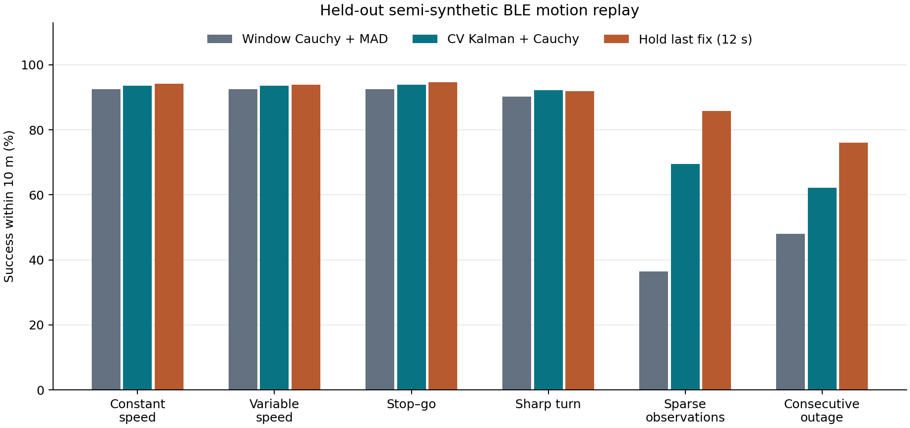

# 移动目标定位研究报告

## 结论

在两处公开 BLE 场地构成的半合成最终轨迹上，**CV Kalman + Cauchy+MAD 的 10 m 成功率由 75.36% 提高到 84.16%**，提高 8.80 个百分点、相对提升 11.67%，低于预设的 20% 目标。收益集中在稀疏和连续缺测。保持最近定位 12 秒的简单基线达到 89.43%，相对提高 18.67%，在本组合的成功率上优于 Kalman。

自动模式在两处原始静态回放均通过预定保护门槛。A、B 的输出条件 CEP90 分别增加 0.14 m、0.03 m。业务明确声明目标静止时，系统走冻结 Cauchy+MAD，1,304 个静态回放时刻逐帧一致。公开真实 BLE 观测提供了 RSSI 来源，移动轨迹与时序由实验构造。

## 原题与操作定义

老师提供的《HarmonyOS难题发布-第七期》第 1 页要求基于所提供的验证数据，在标准场景性能不劣化的条件下使移动目标检测精度提高 20%。原题页未给出命中阈值、具体分母或相对/绝对提升口径。本研究在生成最终集前将 **全部预定时刻中误差 ≤10 m 的比例** 定为主指标，弃权和超阈值均计失败。与冻结 Cauchy 窗口法比较，按相对改善判断 20%，并报告百分点和 5 m、30 m 敏感性。按本组合的 Cauchy 成功率，20% 对应 **90.44%** 的成功率。

这项指标评估目标位置命中率。原题指定数据上的检测表现、静止/移动识别质量和真正移动采集的结论仍待验证。[预登记协议](PROTOCOL.md) · [原题静态核对](../ble_field/PROTOCOL.md)

## 数据和模型

- A 使用 2024 Indoor Environment Dataset 的原始定点记录。B 使用 Position-Annotated-BLE-RSSI-Dataset 的静态 set_1，源数据每 30 秒保留一个 5 秒汇总窗。每条移动回放使用同一发射端，保留的 RSSI 值与对应源记录完全一致。
- 开发、验证、最终按物理坐标隔离。A 分别有 16、16、32 个位置，B 有 10、11、20 个位置。A 的 96 个、B 的 40 个校准位置均与三分区相离。既有校准模型直接复用。最终物理位置沿用历史静态留出集，移动路径、时序和遮蔽方案锁定后首次评估。
- 每个场地在所在分区内从近邻构造平顺和急转路径。每条基础路径含五个不同真实测点。用合成时间表达匀速、变速和停走，并在配对轨迹上设置最多两端可见或连续 2–3 帧缺测。最终集有 **432 条移动轨迹、2,304 个移动时刻**，每场地每类 36 条。不同轨迹可以共享同一分区的物理位置和源窗。
- 每个时刻先用冻结 Cauchy 得到当前位置观测，再在线更新 `[x,y,vx,vy]`。有新观测时用创新修正，缺测时仅在允许时效内且最大位置轴标准差 ≤9 m 时外推。允许时效超限后，有新观测则重新初始化。业务端可用显式静止模式逐帧走冻结 Cauchy。普通自动模式只使用当前及过去的信息。
- 所有方法共用当前窗、冻结本地校准和实验坐标。模型从未输入路径、缺测标签、真值或未来窗口。2 个及以下接收端的 RSSI 在当前实现中无法产生窗口位置，Kalman 此时只能利用历史。

源数据见 [A 发布页](https://data.mendeley.com/datasets/3v9mcsvcd2/1)、[B 发布页](https://github.com/philotuxo/Position-Annotated-BLE-RSSI-Dataset)。移动数据及原始窗口索引见 [开发集](runs/mobile-001/development-data.json.gz)、[验证集](runs/mobile-001/validation-data.json.gz)、[最终集](runs/mobile-001/test-data.json.gz)。

## 最终留出集

### 全场景方法对比

场地×场景等权，组内轨迹等权，轨迹内时刻等权。CEP50/CEP90 条件于有输出。弃权计入全部成功率的分母。下表的保持法在每次得到新 Cauchy 位置时更新，缺测时最多保持 12 秒。

| 方法 | 5 m 成功率 | 10 m 成功率 | 30 m 成功率 | CEP50 / CEP90 (m) | 覆盖率 / 弃权率 | 无输出数 |
| --- | ---: | ---: | ---: | ---: | ---: | ---: |
| 窗口 WLS | 66.48% | 75.15% | 75.68% | 1.94 / 5.28 | 75.68% / 24.32% | 535 |
| 窗口 Cauchy+MAD | 67.43% | 75.36% | 75.68% | 1.98 / 5.09 | 75.68% / 24.32% | 535 |
| 窗口 Soft-L1+MAD | 66.96% | 75.22% | 75.68% | 1.82 / 5.08 | 75.68% / 24.32% | 535 |
| 保持最近 Cauchy，12 s | 74.52% | **89.43%** | **90.88%** | 2.38 / 6.21 | 90.88% / 9.12% | 203 |
| CV Kalman + Cauchy，12 s | 74.13% | 83.88% | 84.57% | 2.07 / 5.33 | 84.57% / 15.43% | 341 |
| CV Kalman + Cauchy，18 s | 74.29% | 84.16% | 84.85% | 2.06 / 5.34 | 84.85% / 15.15% | 335 |

Kalman 相对窗口 Cauchy 少 200 个无输出时刻，输出条件 CEP90 从 5.09 m 升到 5.34 m。保持法覆盖率更高，同时伴随更长的定位年龄和更大的误差尾部。最终 Kalman 对窗口 Cauchy 的增益在 A 为 6.94 个百分点，在 B 为 10.65 个百分点。

### 哪些场景有效

| 移动场景 | 窗口 Cauchy 成功率@10m | 最终 Kalman | 保持最近位置 | Kalman 增量 |
| --- | ---: | ---: | ---: | ---: |
| 匀速 | 92.50% | 93.61% | 94.17% | +1.11 pp |
| 变速 | 92.50% | 93.61% | 93.89% | +1.11 pp |
| 停走 | 92.46% | 93.85% | 94.64% | +1.39 pp |
| 急转 | 90.28% | 92.22% | 91.94% | +1.94 pp |
| 稀疏观测 | 36.39% | 69.44% | 85.83% | +33.06 pp |
| 连续缺测 | 48.06% | 62.22% | 76.11% | +14.17 pp |



200 个预测输出中 191 个在 10 m 内。保持法在这些 191 个时刻也都命中，说明这批预测填补的成功帧可以用更简单的历史规则覆盖。Kalman 共弃权 335 次，其中 137 次尚未得到首个位置、184 次预测不确定性超限、14 次位置过期。无初始化和长缺测仍是主要约束。最差预测发生在 A 的急转轨迹 `A/test/turn/04/1/turn`，第 5 帧距上次修正 7.76 s，Kalman 误差 15.94 m，保持法误差 12.48 m。预测标准差 8.75 m 仍低于 9 m 门槛，体现经验协方差与实际误差之间的差距。[逐帧结果](runs/mobile-001/test-results.json.gz) · [失效诊断](runs/mobile-001/review.json)

### 连续性与更新

| 方法 | 最长连续输出占比 | 全程有输出的轨迹 | 更新间隔 P50 / P90 (s) | 输出位置年龄 P90 (s) |
| --- | ---: | ---: | ---: | ---: |
| 窗口 WLS、Cauchy、Soft-L1 | 68.99% | 51.85% | 5.98 / 16.57 | 0.00 |
| 保持最近位置 | 89.32% | 73.84% | 4.50 / 10.41 | 5.79 |
| 基本 Kalman | 80.46% | 59.49% | 4.71 / 12.95 | 2.35 |
| 最终 Kalman | 80.73% | 59.49% | 4.71 / 12.81 | 2.35 |

输出位置年龄为距上次用到真实窗口定位的时间。窗口法仅在取得位置时输出，因此年龄为零，同时更容易留下长间隔。表中的时间来自合成回放调度，不代表在线 BLE 采集、上报或设备执行延迟。[完整指标](runs/mobile-001/test-metrics.json)

## Agent 迭代和独立裁决

规则式 proposer 读取开发集失败、静态回归与既有试验记录，逐轮选一个机制。Verifier 单独核对配对验证帧，要求父方案的成功率@10m 增加至少 0.50 个百分点，同时满足场景退化与自动静态保护约束。

| 轮次 | 开发信号和改动 | 验证增量 | 裁决 |
| --- | --- | ---: | --- |
| 1 | 125 个失败帧的最后定位年龄处于 12–18 s。时效上限从 12 s 延到 18 s，9 m 不确定性门槛不变 | +0.60 pp | 接受 |
| 2 | 转弯、停走和变速仍有失败。大创新时临时提高状态协方差，以便加快观测修正 | +0.00 pp | 拒绝 |
| 3 | 检验大创新是否源于异常窗口定位。按归一化创新下权 | +0.00 pp | 拒绝 |
| 4 | 检验近邻历史位置是否能支持静止状态。连续近邻定位时抑制速度外推 | +0.00 pp | 拒绝 |

后三种机制在验证中分别改变了 111、46、195 个时刻的位置输出，汇总成功率未达到门槛。放宽时效后最终集相对 12 s Kalman 多输出 6 帧，均来自 B 的稀疏场景，全部在 10 m 内。这些新增输出距上次定位修正仍小于 12 秒。变化来自更长时效允许滤波状态跨过先前间隔并在新观测到达时继续更新，后续短缺测仍受 9 m 上限约束。冻结的最终配置由验证裁决决定。

[第一轮](runs/mobile-001/round-01/verdict.json) · [第二轮](runs/mobile-001/round-02/verdict.json) · [第三轮](runs/mobile-001/round-03/verdict.json) · [第四轮](runs/mobile-001/round-04/verdict.json) · [最终锁](runs/mobile-001/FINAL_LOCK.json)

## 静态保护

从旧分区的同一物理位置和发射端抽取有序窗口，以 4 s 合成间隔回放。标准静态门槛逐场地检查覆盖率不降、10 m 和 30 m 成功率最多下降 1 pp、CEP90 最多增加 0.25 m 或基线值的 5%（取较大者）。

| 静态原始回放 | 方法 | CEP90 (m) | 覆盖率 | 成功率@10m | 成功率@30m |
| --- | --- | ---: | ---: | ---: | ---: |
| A，32 个位置 | 冻结窗口 Cauchy | 5.95 | 78.91% | 77.73% | 78.91% |
| A，32 个位置 | Kalman 自动 | 6.09 | 87.50% | 87.11% | 87.50% |
| B，20 个位置 | 冻结窗口 Cauchy | 5.43 | 100% | 100% | 100% |
| B，20 个位置 | Kalman 自动 | 5.46 | 100% | 100% | 100% |

两处均过预设门槛，自动模式存在小幅尾部变化。附加四类静态压力复用坐标误差、设备异质性、50% 缺测、单侧几何。A 和 B 的 50% 缺测组成功率@10m 分别由 69.01%、54.37% 升到 88.21%、75.00%。B 的单侧组由 76.87% 降到 76.25%。静态标准保护的证据限于这两处回放。业务明确给定静止时，1,304 帧的输出和弃权与冻结 Cauchy 逐帧相等。[静态保护检查](runs/mobile-001/test-static-guard.json)

## 复现与边界

三项程序测试通过，覆盖初始化与修正、缺测外推和过期重置、协方差弃权和显式静止。独立复核检查数据隔离、真实 RSSI 的保留、时序和缺测区间，重放四轮裁决，独立重算成功率，并截断 22 条路线验证过去输出对未来帧不敏感。完整另目录复跑的七份核心产物 SHA-256 一致。静态快照 689 个文件通过核验。[复核记录](runs/mobile-001/review.json)

本阶段支持的结论是短时历史能填补部分当前窗缺测，Kalman 在本组合的主指标提升 11.67%。路线是固定接收设施内五个测量点的空间重排，速度约 0.45–1.50 m/s，连续移动中的真实 BLE 时序、遮挡和上报延迟仍缺数据。正式验收还需原题验证集及其命中定义。复杂运动状态或更长外推的增益也有待用真实移动采集与保持基线验证。

### 使用

从仓库根目录按 [复现协议](PROTOCOL.md) 执行。逐帧应用入口为 [Tracker.update](tracker.py)，每个目标单独创建实例，按秒传入单调递增的时间戳、接收端米制坐标、含空值的 RSSI 和本地校准模型。`Update` 返回坐标、速度、输出原因、位置年龄及估计标准差。最终实验配置可从 [方法锁](runs/mobile-001/FINAL_LOCK.json) 读取。

```python
from ble_mobile.tracker import Tracker

tracker = Tracker({"max_coast_s": 18.0})
result = tracker.update(timestamp_s, receiver_xy, rssi_dbm, calibration)
```
